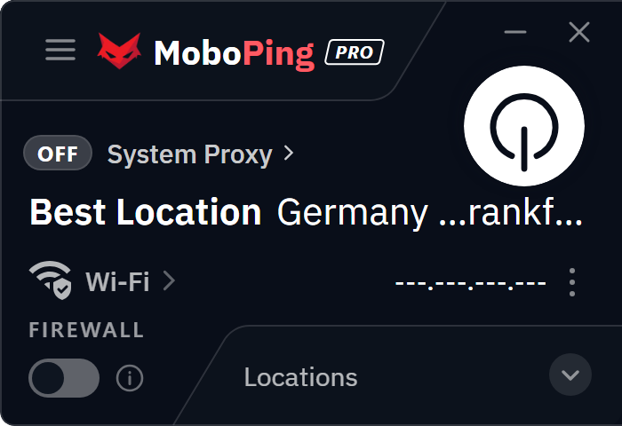
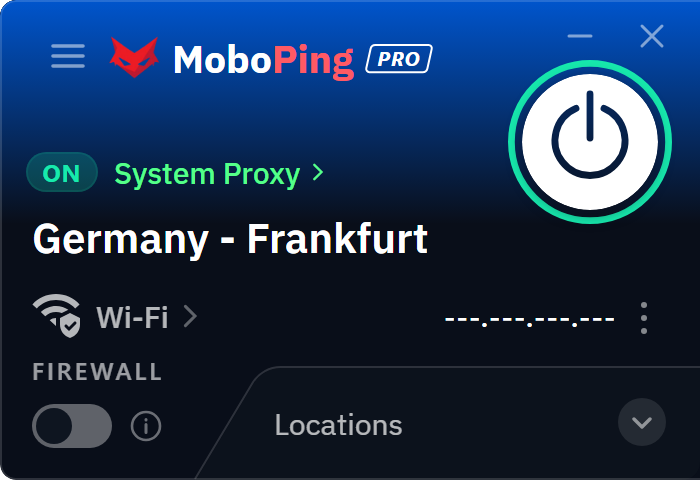

# MoboPing

 &nbsp;&nbsp; 

**[دانلود آخرین نسخه / Download latest version](https://github.com/Alighandchi/MoboPing/releases/latest)**

---

## فارسی

**MoboPing** یک کلاینت VPN و پروکسی برای ویندوز است که توسط **iMobotech** ساخته شده است. با نصب آن می‌توانید به سرویس متصل شوید، بهترین سرور را به‌صورت خودکار انتخاب کنید و دسترسی خود را به اینترنت امن‌تر کنید.

### ویژگی‌ها

- اتصال با یک کلیک و نمایش وضعیت اتصال روی صفحه‌ی اصلی.
- انتخاب خودکار بهترین لوکیشن یا انتخاب دستی لوکیشن، همراه با نمایش پینگ هر سرور.
- حالت‌های اتصال: **System Proxy** و **System VPN**.
- Split Tunneling: تعیین برنامه‌ها و دامنه‌هایی که باید از تونل عبور کنند یا نکنند.
- تنظیمات فایروال برای کنترل ترافیک و جلوگیری از نشت اتصال.
- نمودار ترافیک زنده و تست سرعت.
- تست نشت DNS و WebRTC.
- به‌روزرسانی خودکار برنامه از داخل خود برنامه.
- پشتیبانی از زبان فارسی و انگلیسی.

### دانلود و نصب

1. از صفحه‌ی [Releases](https://github.com/Alighandchi/MoboPing/releases/latest) آخرین فایل **`MoboPing-Setup-x.y.z.exe`** را دانلود کنید.
2. فایل دانلود شده را اجرا کنید. ویندوز ممکن است درخواست دسترسی مدیر (UAC) نشان دهد؛ آن را تأیید کنید.
3. مراحل نصب را تا پایان دنبال کنید و سپس MoboPing را باز کنید.
4. با **شناسه‌ی اشتراک** (Subscription ID) یا لینک اشتراک خود وارد شوید.

> نکته: این مخزن فقط برای دانلود فایل‌های نصب است و کدهای منبع برنامه در آن قرار ندارند.

### نیازمندی‌ها

- ویندوز ۱۰ یا ویندوز ۱۱ (نسخه‌ی ۶۴ بیتی)
- دسترسی مدیر برای نصب

### به‌روزرسانی

پس از نصب، MoboPing نسخه‌های جدید را از سرور خودش دریافت و نصب می‌کند. نیازی به دانلود دستی مجدد نیست. این مخزن برای نصب اولیه یا زمانی است که دسترسی به سرور به‌روزرسانی ممکن نباشد.

### پشتیبانی

- ربات پشتیبانی: [t.me/moboping_bot](https://t.me/moboping_bot)
- کانال خبری: [t.me/Moboping](https://t.me/Moboping)

---

## English

**MoboPing** is a VPN and proxy client for Windows, built by **iMobotech**. After installing it you can connect to the service, let the app pick the best server automatically, and browse with more privacy.

### Features

- One-click connect with a clear connection status on the main screen.
- Automatic best-location selection or manual choice, with the ping of every server shown.
- Connection modes: **System Proxy** and **System VPN**.
- Split Tunneling: choose which apps and domains go through the tunnel and which do not.
- Firewall options to control traffic and prevent connection leaks.
- Live traffic graph and speed test.
- DNS and WebRTC leak test.
- Built-in automatic updates.
- Persian and English interface.

### Download and install

1. Open the [Releases](https://github.com/Alighandchi/MoboPing/releases/latest) page and download the latest **`MoboPing-Setup-x.y.z.exe`**.
2. Run the file. Windows may ask for administrator permission (UAC); accept it.
3. Follow the installer steps to the end, then start MoboPing.
4. Sign in with your **Subscription ID** or your subscription link.

> Note: this repository only distributes the installer. The application source code is not included here.

### Requirements

- Windows 10 or Windows 11 (64-bit)
- Administrator rights for installation

### Updates

After installation, MoboPing downloads and installs new versions from its own update server, so you do not need to download the installer again. This repository is meant for the first install, or for cases where the update server cannot be reached.

### Support

- Support bot: [t.me/moboping_bot](https://t.me/moboping_bot)
- Channel: [t.me/Moboping](https://t.me/Moboping)

---

© iMobotech · MoboPing

